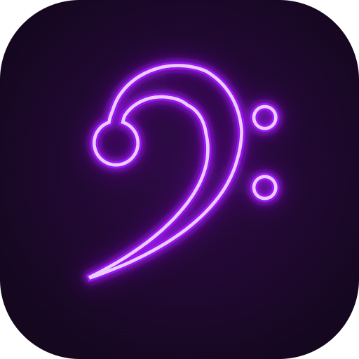
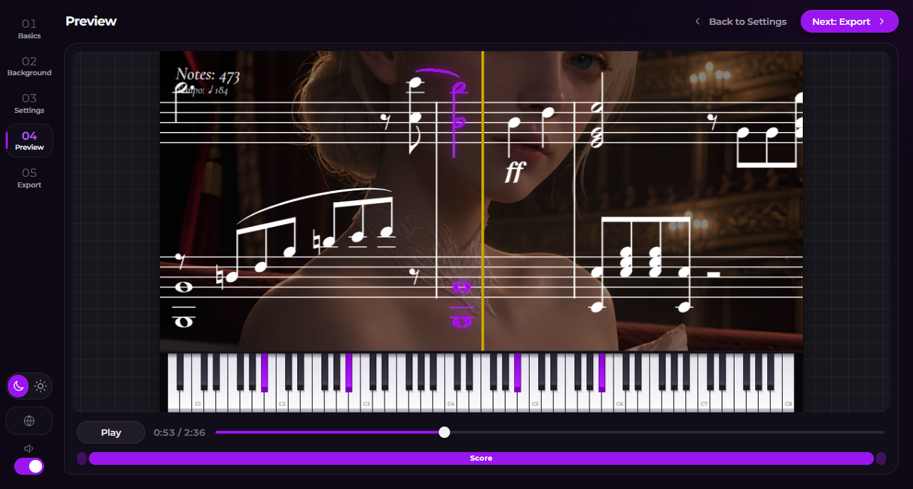
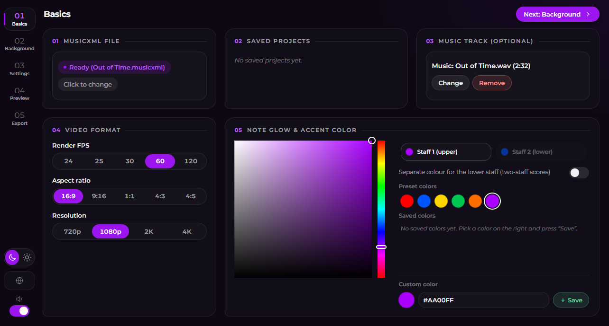
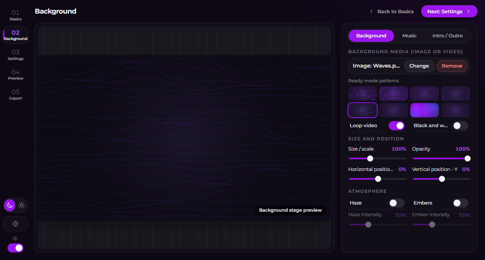
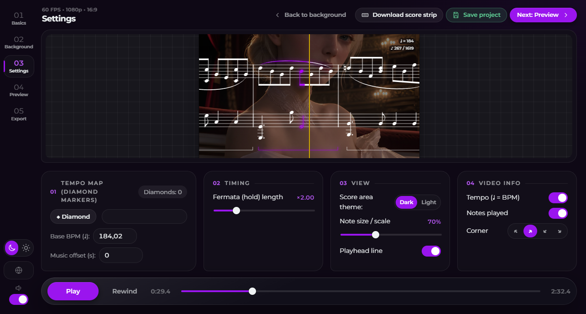
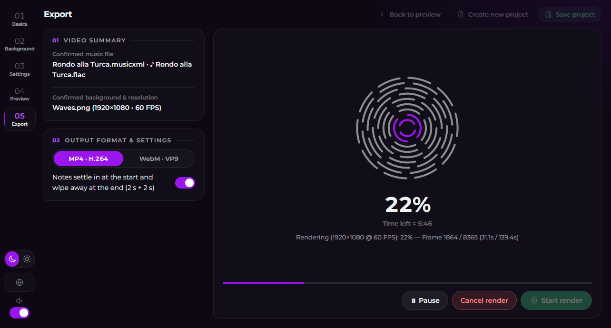

<p align="center">
  
</p>

<h1 align="center">Eqo Partitura</h1>

<p align="center"><b>Eqo Partitura · Echo Studio</b> — Echo Masterworks</p>

<p align="center">
  Turn a MusicXML score into a smooth, scrolling sheet-music video — with the active notes glowing in the color you choose.<br/>
  Desktop app for Windows and Linux · MP4 (H.264 + AAC) / WebM (VP9 + Opus) · 10 languages · open source (MIT)
</p>

<p align="center">
  <a href="README.tr.md">Türkçe</a>
</p>



## Features

- **Drop a score, get a video.** `.musicxml`, `.xml` and compressed `.mxl` files are supported.
- **Frame-exact rendering.** Videos are encoded frame by frame with WebCodecs. They are not screen-recorded, so timing, duration and frame rate are exact.
- **Glowing active notes.** The notehead, stem, beam, ledger lines, ornaments (trill, mordent, …), fermatas, dynamics, hairpins and pedal marks of the sounding note all light up. Pick a preset, any color from the always-open picker, or one of your saved colors. Choose a light or dark score theme, and show or hide the playhead line.
- **Seek anywhere.** Use the seek bar, click a note, drag the strip, or press ←/→ to start the preview from any point.
- **Fermatas count.** Held notes are stretched ×2.0 by default (the same as MuseScore), and you can adjust this from ×1 to ×6.
- **Tempo that follows the score.** The tempo written in the file (♩ = 90 and so on) is applied automatically, and tempo changes become *tempo diamonds*. You can add, edit or delete diamonds anywhere on the strip.
- **Background studio.** Use an image or a looping video as the background, with scale, opacity, position and grayscale controls — or one of the ready-made patterns (hexagons, triangles, grid, dots, waves, lines, light, staves).
- **Piano keyboard (optional).** A keyboard along the bottom of the video; the keys of the sounding notes are pressed in the glow colour of their staff.
- **Look templates.** Save a look and reuse it on another piece.
- **Tap tempo, undo and autosave.** Tap along with the recording to set the tempo; <kbd>Ctrl</kbd>+<kbd>Z</kbd> / <kbd>Ctrl</kbd>+<kbd>Y</kbd> for the settings; a saved project keeps saving itself.
- **Live info in the video (optional).** Notes played so far, speed in notes per second and the tempo heard right now (rit. and accel. included), set in italic serif type in a corner you choose.
- **See the finished video first.** The Preview page plays the whole video — intro and outro screens, background, effects and sound — drawn by the render's own code, before you render.
- **Optional music track.** Add an MP3 / WAV / OGG / M4A / FLAC file and align it with a start offset (to the millisecond). Set the volume and optionally extend the video until the music ends. The track is muxed into the video, and the preview plays it in sync.
- **Any format.** Aspect ratios 16:9, 9:16, 1:1, 4:3, 4:5; resolutions 720p, 1080p, 2K, 4K; frame rates 24/25/30/60/120 fps; the video bitrate follows size and frame rate.
- **Streams to disk.** Long 4K renders don't fill up RAM: the video is written straight into the file you pick.
- **HD score strip export** as PNG, JPEG, WebP or SVG.
- **Projects.** Save and reopen everything: score, background, music and settings.
- **10 languages:** Türkçe, English, Deutsch, Français, Español, Italiano, Português, Русский, 日本語, 中文.
- **Offline.** All fonts are embedded and nothing is downloaded at runtime.

| 1 · Basics | 2 · Background | 3 · Settings |
| --- | --- | --- |
|  |  |  |

| 4 · Preview | 5 · Export |
| --- | --- |
|  |  |

## Download

Get the latest build from the **[Releases](../../releases)** page. Both are single files with nothing to install.

| System | File | |
| --- | --- | --- |
| Windows 10 / 11 (x64) | **`Eqo-Partitura.exe`** | Double-click to run. |
| Linux (x86_64), any distribution | **`Eqo-Partitura-x86_64.AppImage`** | Make it executable, then double-click or run it. |

> **Windows:** the builds are not code-signed yet, so SmartScreen may show *"Windows protected your PC"*. Click **More info → Run anyway**.

**Linux:** in the file manager open *Properties → Permissions* and tick *Allow executing file as program*, or in a terminal:

```bash
chmod +x Eqo-Partitura-x86_64.AppImage
./Eqo-Partitura-x86_64.AppImage
```

The AppImage uses the static AppImage runtime, so it does not need `libfuse2`. It is meant for current x86_64 distributions (Ubuntu, Debian, Fedora, Arch, openSUSE, Mint …). It does not run on musl-based systems such as Alpine. On Linux, Chromium has no AAC encoder, so MP4 videos get Opus audio (plays in browsers, VLC, YouTube and most players). On systems that block unprivileged user namespaces (for example Ubuntu 24.04 and later), the launcher starts the app without Chromium's OS-level sandbox; the renderer's own isolation described under *Security* stays in place. If you want a menu entry, use a tool such as [Gear Lever](https://flathub.org/apps/it.mijorus.gearlever) or AppImageLauncher.

## How to use

1. **Basics:** choose the MusicXML file and, optionally, a music track; frame rate, aspect ratio, resolution and the glow colour.
2. **Background:** optionally add an image or video background (or pick a ready-made pattern), haze and embers, the music's volume and offset, and intro / outro screens.
3. **Settings:** play the score (<kbd>Space</kbd>) and fine-tune the BPM, tempo diamonds, fermatas, note size, score theme and the optional live info.
4. **Preview:** watch the finished video as it will be rendered.
5. **Export:** choose MP4 or WebM, click **Start render** (bottom right) and pick where to save; pause or cancel at any time.

The sidebar jumps to any step whose way is open. The interface starts in English and keeps the language you choose.

Keyboard shortcuts: <kbd>Space</kbd> play/pause · <kbd>←</kbd>/<kbd>→</kbd> previous/next note · <kbd>Shift</kbd>+<kbd>←</kbd>/<kbd>→</kbd> ±5 s · <kbd>Home</kbd>/<kbd>End</kbd> start/end · <kbd>T</kbd> tap tempo · <kbd>Ctrl</kbd>+<kbd>Z</kbd> / <kbd>Ctrl</kbd>+<kbd>Y</kbd> undo / redo · <kbd>Ctrl</kbd>+<kbd>S</kbd> save project · <kbd>F11</kbd> full screen · <kbd>Esc</kbd> close dialog. Closing the window with unsaved changes asks first (Save / Don't save / Cancel).

Projects are stored in `%USERPROFILE%\.eqo-partitura\projects` on Windows and `~/.eqo-partitura/projects` on Linux.

## Building from source

Requirements: [Node.js](https://nodejs.org/) 20 or newer. Build the `.exe` on Windows and the AppImage on Linux.

```bash
npm install
npm run dev          # Vite + Electron with hot reload (alias: npm run electron:dev)
npm run dist:win     # Windows -> "Eqo-Partitura.exe" in the project folder (build leftovers are removed)
npm run dist:linux   # Linux   -> release/Eqo-Partitura-x86_64.AppImage
```

Other scripts:

- `npm run build` builds the UI bundle only.
- `npm run web` opens the UI in a normal browser (project saving is off in this mode).

Pushing a tag such as `v1.0.0` makes GitHub Actions build `Eqo-Partitura.exe` and `Eqo-Partitura-x86_64.AppImage`, start the AppImage once as a check, and attach both to a GitHub Release (see `.github/workflows/release.yml`).

## Contributing

Bug reports and pull requests are welcome in [Issues](../../issues). Please keep the security model below intact. Any new IPC call must check its sender and validate its arguments like the existing ones.

## Project structure

```
electron/            Main process (Node.js)
  main.js            Window, app:// protocol, Content-Security-Policy, navigation / permission lockdown
  preload.cjs        The only renderer ↔ system bridge (window.echo)
  ipc-*.js           Validated IPC handlers: projects, save dialogs, streamed video writing
src/                 Renderer (sandboxed, no Node.js access)
  main.js            UI wiring for the 5-step wizard
  i18n.js            Translations (10 languages, identical key sets)
  core/              Score loading (OSMD), timeline, playback, render & audio engines
  platform/          Project storage client and file output (desktop + browser fallback)
  ui/                Dialogs, language menu, colour picker, interface sounds, render animation
  styles/            Diapason design language, app stylesheet and embedded fonts
  assets/brand/      Eqo Partitura app icon
build/               Packaging resources (icon.ico, icon.png)
brand/               Echo Masterworks intro (16:9 splash, logo + sound), reusable in other apps
scripts/             dev launcher, exe collector
docs/screenshots/    README images
```

## Security

- The renderer runs with `sandbox: true`, `contextIsolation: true` and `nodeIntegration: false`. It has no direct file system or Node.js access.
- The production UI is served from a private `app://` scheme with a strict Content-Security-Policy. It allows only its own scripts: no inline scripts, no `eval`, and no network requests.
- IPC handlers verify the sender and validate every argument. The renderer can only write into a file the user picked in a native save dialog.
- New windows, navigation away from the app, `<webview>` and all permission requests (camera, microphone, …) are blocked. DevTools and the menu are disabled in release builds.

## Third-party software

[OpenSheetMusicDisplay](https://github.com/opensheetmusicdisplay/opensheetmusicdisplay) (BSD-3-Clause) with [VexFlow](https://github.com/0xfe/vexflow) (MIT), [mp4-muxer](https://github.com/Vanilagy/mp4-muxer) and [webm-muxer](https://github.com/Vanilagy/webm-muxer) (MIT), [Electron](https://www.electronjs.org/) (MIT), [Vite](https://vitejs.dev/) (MIT), and the fonts [Manrope](https://github.com/sharanda/manrope), [Noto Sans JP](https://fonts.google.com/noto/specimen/Noto+Sans+JP) and [Noto Sans SC](https://fonts.google.com/noto/specimen/Noto+Sans+SC), Cormorant Garamond and Playfair Display (SIL Open Font License 1.1) via Fontsource, and [Edwin](https://github.com/MuseScoreFonts/Edwin), MuseScore's text font, for the text in the notation (SIL Open Font License 1.1, © MuseScore BVBA). The interface serif *Diapason* is based on [Tinos](https://github.com/googlefonts/tinos) (SIL Open Font License 1.1, see `src/styles/fontlar/LICENSE-OFL.txt`).

## License

The source code is released under the [MIT](LICENSE) license © 2026 Echo Masterworks.

The names **Eqo Partitura**, **Echo Studio** and **Echo Masterworks** and their logos, icons and intro sound (`brand/`, `src/assets/brand/`, `build/icon.*`) identify the official app and are not covered by the MIT license. You may use them unchanged to build and run this project. If you publish a modified version, please give it your own name and icon.
