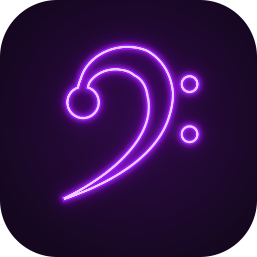
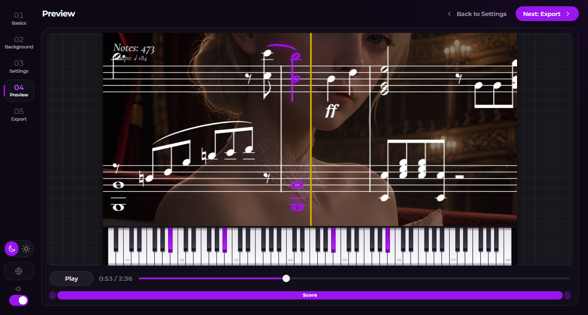
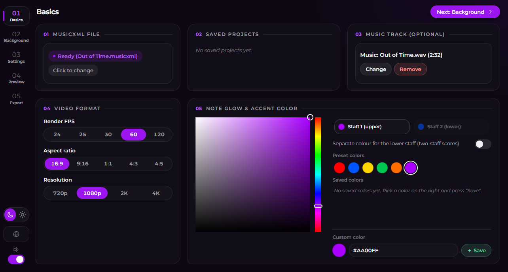
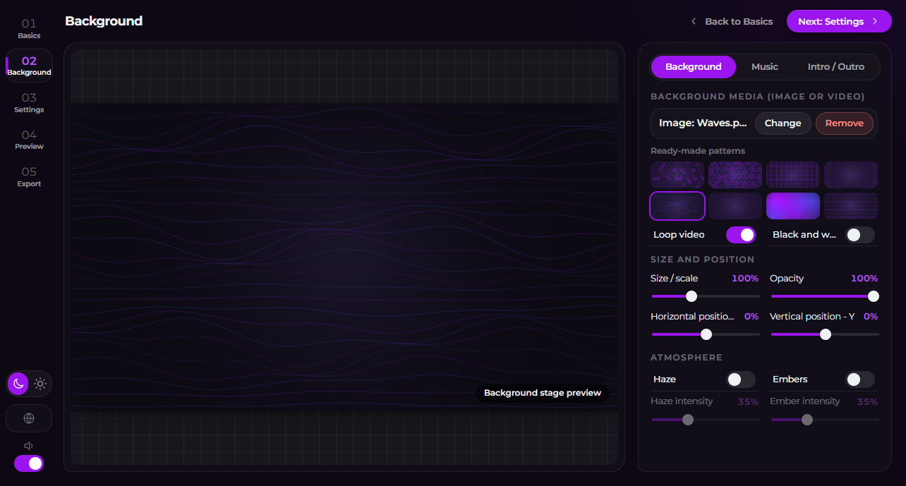
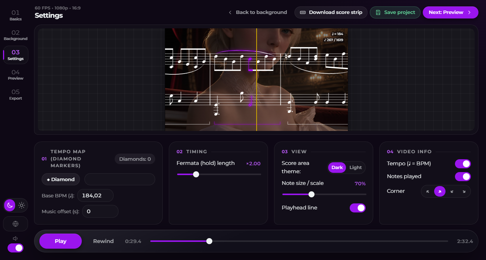
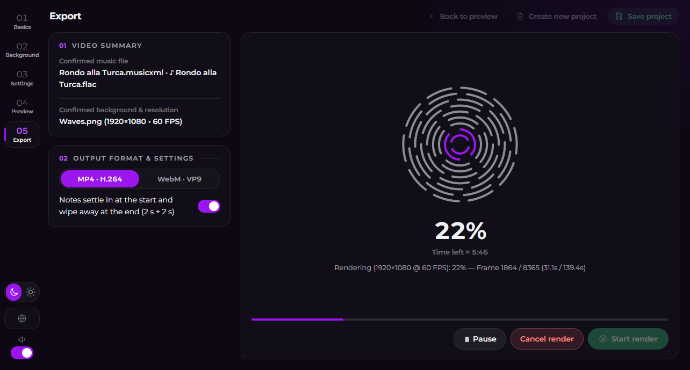

<p align="center">
  
</p>

<h1 align="center">Eqo Partitura</h1>

<p align="center"><b>Eqo Partitura · Echo Studio</b> — Echo Masterworks</p>

<p align="center">
  MusicXML notanızı, çalan notaların seçtiğiniz renkte parladığı akıcı bir nota videosuna dönüştürür.<br/>
  Windows ve Linux masaüstü uygulaması · MP4 (H.264 + AAC) / WebM (VP9 + Opus) · 10 dil · açık kaynak (MIT)
</p>

<p align="center">
  <a href="README.md">English</a>
</p>



## Özellikler

- **Notayı bırakın, videoyu alın.** `.musicxml`, `.xml` ve sıkıştırılmış `.mxl` dosyaları desteklenir.
- **Kare kare kesin render.** Video ekran kaydı değildir; WebCodecs ile kare kare kodlanır. Süre, zamanlama ve kare hızı birebir doğrudur.
- **Parlayan aktif notalar.** Çalan notanın başı, sapı, kirişi, ek çizgileri, süslemeleri (tril, mordent…), fermatası, nüansı, crescendo çatalı ve pedal işareti birlikte parlar. Hazır renklerden birini, her zaman açık seçiciden istediğiniz rengi ya da kayıtlı renklerinizi kullanın. Nota alanı için açık/koyu tema seçebilir, imleç çizgisini açıp kapatabilirsiniz.
- **İstediğiniz yerden başlatın.** Sarma çubuğunu kullanın, bir notaya tıklayın, şeridi sürükleyin ya da ←/→ tuşlarına basın.
- **Dur işaretleri (fermata) hesaba katılır.** Fermatalı notalar varsayılan olarak ×2.0 tutulur (MuseScore ile aynı); bu oranı ×1–×6 arasında değiştirebilirsiniz.
- **Notadaki tempo otomatik.** Dosyada yazan tempo (♩ = 90 vb.) otomatik uygulanır; tempo değişimleri *elmas* işaretçilere dönüşür. Elmasları şeridin istediğiniz yerine ekleyebilir, düzenleyebilir ve silebilirsiniz.
- **Arka plan stüdyosu.** Arka plana görsel ya da döngülü video koyabilirsiniz; ölçek, opaklık, konum ve siyah-beyaz ayarlarıyla — ya da hazır desenlerden birini seçebilirsiniz (altıgen, üçgen, ızgara, noktalar, dalgalar, çizgiler, ışık, porte).
- **Piyano klavyesi (isteğe bağlı).** Videonun altında bir klavye; çalan notaların tuşları kendi portelerinin parlama rengiyle basılır.
- **Görünüm şablonları.** Bir görünümü kaydedip başka eserlerde kullanın.
- **Tap tempo, geri al ve otomatik kayıt.** Kayıtla birlikte dokunarak tempoyu bulun; ayarlarda <kbd>Ctrl</kbd>+<kbd>Z</kbd> / <kbd>Ctrl</kbd>+<kbd>Y</kbd>; kaydedilmiş proje kendini kaydetmeye devam eder.
- **Videoda canlı bilgi (isteğe bağlı).** O ana kadar çalınan nota sayısı, saniyedeki nota sayısıyla hız ve o an duyulan tempo (rit. ve accel. dahil); seçtiğiniz köşede, italik serif yazıyla.
- **Önce bitmiş videoyu gör.** Önizleme sayfası, render almadan önce videonun tamamını oynatır: açılış ve kapanış ekranları, arka plan, efektler ve ses; render'ın kendi çizim koduyla.
- **İsteğe bağlı müzik parçası.** MP3 / WAV / OGG / M4A / FLAC ekleyin ve başlangıç kaydırmasıyla (milisaniye hassasiyetinde) notalarla hizalayın. Ses seviyesini ayarlayabilir, isterseniz videoyu müzik bitene kadar uzatabilirsiniz. Ses videoya gömülür, önizlemede de senkron çalar.
- **Her formata uygun.** En/boy oranları 16:9, 9:16, 1:1, 4:3, 4:5; çözünürlükler 720p, 1080p, 2K, 4K; 24/25/30/60/120 FPS; video bit hızı boyuta ve FPS'e göre otomatik ayarlanır.

| 1 · Temel | 2 · Arka plan | 3 · Ayarlar |
| --- | --- | --- |
|  |  |  |

| 4 · Önizleme | 5 · Çıktı |
| --- | --- |
|  |  |
- **Doğrudan diske yazar.** Uzun 4K render'lar belleği doldurmaz: video seçtiğiniz dosyaya parça parça yazılır.
- **HD nota şeridi** dışa aktarımı: PNG, JPEG, WebP veya SVG.
- **Projeler.** Nota, arka plan, müzik ve tüm ayarları kaydedip yeniden açabilirsiniz.
- **10 dil:** Türkçe, English, Deutsch, Français, Español, Italiano, Português, Русский, 日本語, 中文.
- **İnternet gerekmez.** Tüm yazı tipleri uygulamaya gömülüdür, çalışırken hiçbir şey indirilmez.

## İndirme

En güncel sürümü **[Releases](../../releases)** sayfasından indirin. İki dosya da tek parçadır, kurulum gerekmez.

| Sistem | Dosya | |
| --- | --- | --- |
| Windows 10 / 11 (x64) | **`Eqo-Partitura.exe`** | Çift tıklayın. |
| Linux (x86_64), her dağıtım | **`Eqo-Partitura-x86_64.AppImage`** | Çalıştırma izni verin, sonra çift tıklayın veya çalıştırın. |

> **Windows:** dosyalar henüz kod imzalı olmadığından SmartScreen *"Windows bilgisayarınızı korudu"* uyarısı gösterebilir. **Ek bilgi → Yine de çalıştır** ile açabilirsiniz.

**Linux:** dosya yöneticisinde *Özellikler → İzinler* bölümünden *Dosyanın program olarak çalıştırılmasına izin ver*'i işaretleyin ya da terminalde:

```bash
chmod +x Eqo-Partitura-x86_64.AppImage
./Eqo-Partitura-x86_64.AppImage
```

AppImage statik AppImage çalışma zamanını kullanır, `libfuse2` gerektirmez. Güncel x86_64 dağıtımlar için hazırlanmıştır (Ubuntu, Debian, Fedora, Arch, openSUSE, Mint …). Alpine gibi musl tabanlı sistemlerde çalışmaz. Linux'ta Chromium'da AAC kodlayıcı olmadığından MP4 videoların sesi Opus olur (tarayıcılarda, VLC'de, YouTube'da ve çoğu oynatıcıda çalışır). Ayrıcalıksız kullanıcı ad alanlarını engelleyen sistemlerde (ör. Ubuntu 24.04 ve sonrası) başlatıcı, uygulamayı Chromium'un işletim sistemi düzeyindeki korumalı alanı olmadan açar; *Güvenlik* bölümündeki arayüz yalıtımı yerinde kalır. Menüde görünmesini isterseniz [Gear Lever](https://flathub.org/apps/it.mijorus.gearlever) veya AppImageLauncher gibi bir araç kullanabilirsiniz.

## Kullanım

1. **Temel:** MusicXML dosyasını ve isterseniz müzik parçasını seçin; FPS, en/boy oranı, çözünürlük ve parlama rengi.
2. **Arka plan:** İsterseniz görsel/video arka plan ya da hazır desen, sis ve kıvılcım, müziğin ses seviyesi ve kaydırması, açılış/kapanış ekranları.
3. **Ayarlar:** Notayı oynatın (<kbd>Boşluk</kbd>); BPM'i, tempo elmaslarını, fermataları, nota boyutunu, nota temasını ve isteğe bağlı video bilgilerini ayarlayın.
4. **Önizleme:** Videonun render'da çıkacak son halini izleyin.
5. **Çıktı:** MP4 veya WebM'i seçin, sağ alttaki **Render işlemini başlat**'a tıklayıp kayıt yerini belirleyin; istediğiniz an duraklatıp iptal edebilirsiniz.

Yan panelden yolu açık olan her adıma atlanabilir. Arayüz İngilizce açılır, seçtiğiniz dili hatırlar.

Kısayollar: <kbd>Boşluk</kbd> oynat/duraklat · <kbd>←</kbd>/<kbd>→</kbd> önceki/sonraki nota · <kbd>Shift</kbd>+<kbd>←</kbd>/<kbd>→</kbd> ±5 sn · <kbd>Home</kbd>/<kbd>End</kbd> başa/sona · <kbd>T</kbd> tempoya dokun · <kbd>Ctrl</kbd>+<kbd>Z</kbd> / <kbd>Ctrl</kbd>+<kbd>Y</kbd> geri al / yinele · <kbd>Ctrl</kbd>+<kbd>S</kbd> projeyi kaydet · <kbd>F11</kbd> tam ekran · <kbd>Esc</kbd> pencereyi kapat. Kaydedilmemiş değişiklikle kapatırken uygulama önce sorar (Kaydet / Kaydetme / İptal).

Projeler Windows'ta `%USERPROFILE%\.eqo-partitura\projects`, Linux'ta `~/.eqo-partitura/projects` klasöründe saklanır.

## Kaynaktan derleme

Gereksinimler: [Node.js](https://nodejs.org/) 20 veya üzeri. `.exe` Windows'ta, AppImage Linux'ta derlenir.

```bash
npm install
npm run dev          # Vite + Electron, anlık yenileme ile (eş anlamlısı: npm run electron:dev)
npm run dist:win     # Windows -> proje klasörüne "Eqo-Partitura.exe" (ara dosyalar silinir)
npm run dist:linux   # Linux   -> release/Eqo-Partitura-x86_64.AppImage
```

Diğer betikler:

- `npm run build`: yalnızca arayüz paketini derler.
- `npm run web`: arayüzü normal tarayıcıda açar (bu modda proje kaydetme kapalıdır).

`v1.0.0` gibi bir etiket (tag) gönderildiğinde GitHub Actions `Eqo-Partitura.exe` ve `Eqo-Partitura-x86_64.AppImage` dosyalarını derler, AppImage'ı bir kez açarak dener ve ikisini bir GitHub Release'e ekler (`.github/workflows/release.yml`).

## Katkı

Hata bildirimleri ve pull request'ler [Issues](../../issues) üzerinden memnuniyetle karşılanır. Lütfen güvenlik modelini koruyun: her yeni IPC çağrısı, mevcutlar gibi göndereni ve tüm argümanları denetlemelidir.

## Lisans

Kaynak kodu [MIT](LICENSE) lisansıyla yayınlanmıştır © 2026 Echo Masterworks.

**Eqo Partitura**, **Echo Studio** ve **Echo Masterworks** adları ile logoları, simgeleri ve açılış sesi (`brand/`, `src/assets/brand/`, `build/icon.*`) resmî uygulamayı tanıtır ve MIT lisansının kapsamında değildir. Bu projeyi derlemek ve çalıştırmak için değiştirmeden kullanabilirsiniz. Değiştirilmiş bir sürüm yayınlarsanız lütfen kendi adınızı ve simgenizi kullanın.

Klasör yapısı, güvenlik modeli ve üçüncü taraf yazılımlar için [README.md](README.md) dosyasına bakın.
